# Playlist Maker

<div align="center">


*An Android app for searching music, listening to previews and building your own playlists*

[Features](#features) • [Screenshots](#screenshots) • [Tech Stack](#tech-stack) • [Architecture](#architecture) • [Project Structure](#project-structure)

</div>

---

## About

Playlist Maker is an Android application for searching music tracks via the iTunes Search API, listening to 30-second previews, saving favorite tracks and organizing them into playlists.

The UI is built entirely with **Jetpack Compose**: a single Activity hosts **Navigation Compose**, and every screen is a separate composable function. The project follows **Clean Architecture** and **MVVM** with a feature-based package structure.

The project was developed as part of the Yandex Practicum Android Developer course.

---

## Features

### Search
- Search tracks with the iTunes Search API (automatic search after a pause in typing, or immediately on the keyboard action)
- Loading, "nothing found" and "no connection" states with a retry button
- Search history of the last opened tracks, shown when the search field is focused and empty

### Audio Player
- 30-second track preview with play/pause and playback progress
- Playback runs in a bound service; while a track is playing and the app goes to the background, a notification is shown
- Add the track to favorites
- Add the track to a playlist from a bottom sheet, or create a new playlist right from it

### Media Library
- **Favorite tracks** tab
- **Playlists** tab: a grid of playlists with covers and track counts

### Playlists
- Create and edit a playlist: cover (system photo picker), name and description
- Playlist screen: cover, description, total duration and track count, list of tracks in a bottom sheet
- Remove a track from a playlist (long press)
- Share a playlist as a text list of tracks
- Delete a playlist

### Settings
- Dark theme switch (applied app-wide and remembered)
- Share the app
- Write to support (email)
- Open the user agreement

---

## Screenshots

### Light theme

<table>
  <tr>
    <td align="center">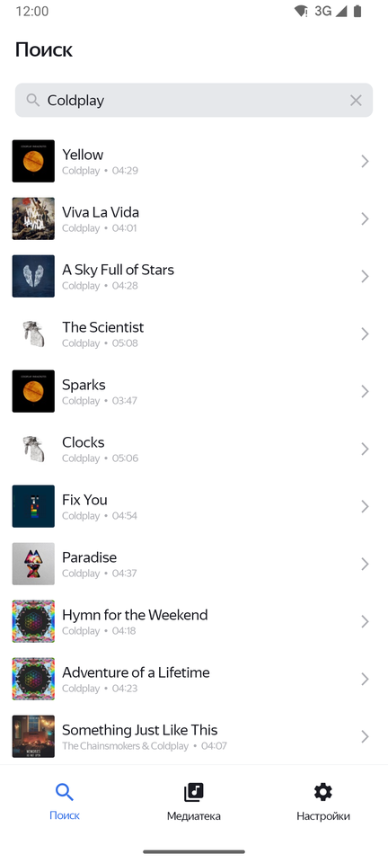<br><sub>Search</sub></td>
    <td align="center">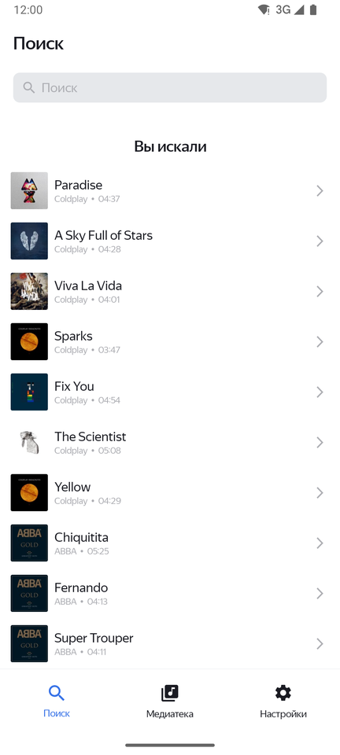<br><sub>Search history</sub></td>
    <td align="center">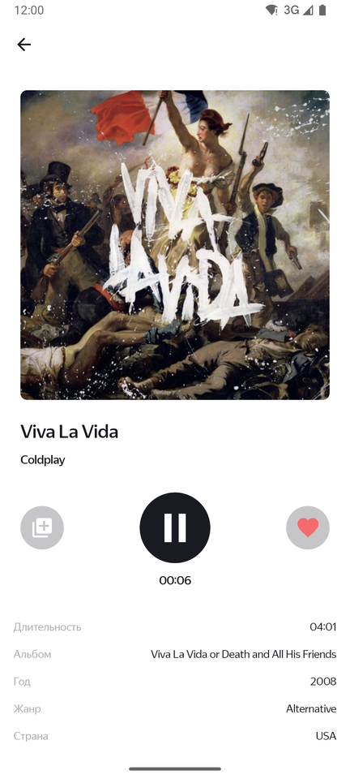<br><sub>Audio player</sub></td>
    <td align="center">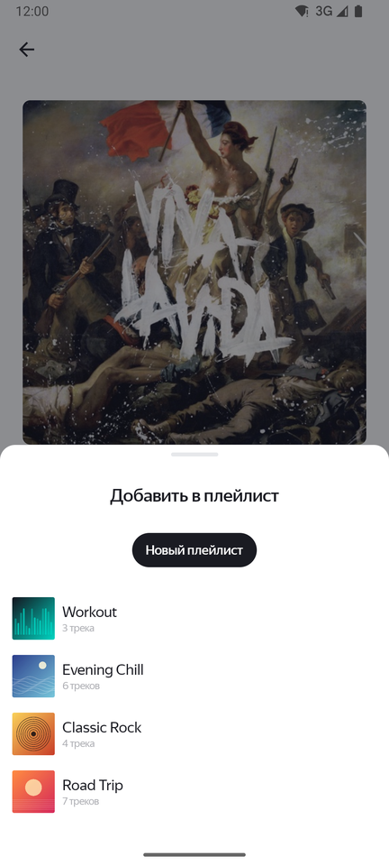<br><sub>Add to playlist</sub></td>
    <td align="center">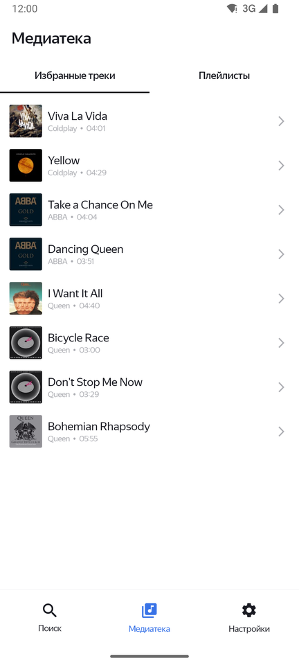<br><sub>Favorite tracks</sub></td>
  </tr>
  <tr>
    <td align="center">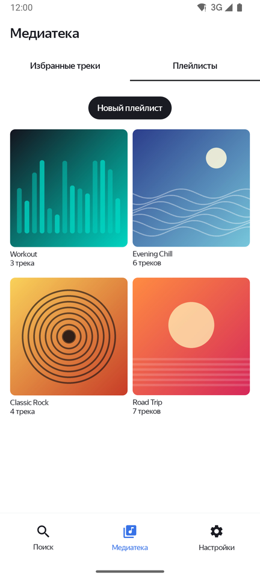<br><sub>Playlists</sub></td>
    <td align="center">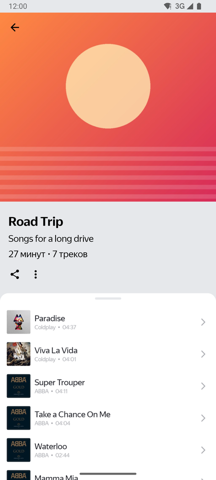<br><sub>Playlist</sub></td>
    <td align="center">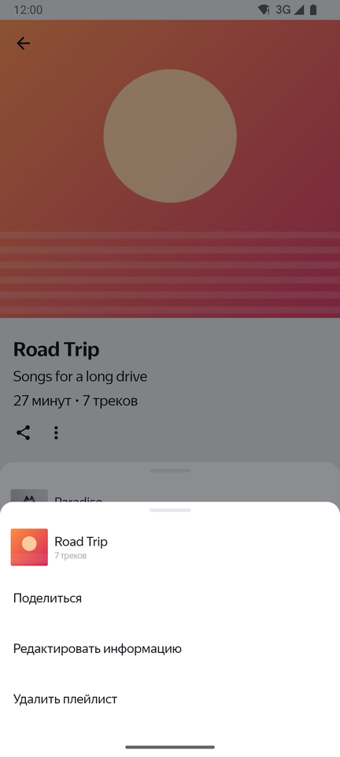<br><sub>Playlist menu</sub></td>
    <td align="center">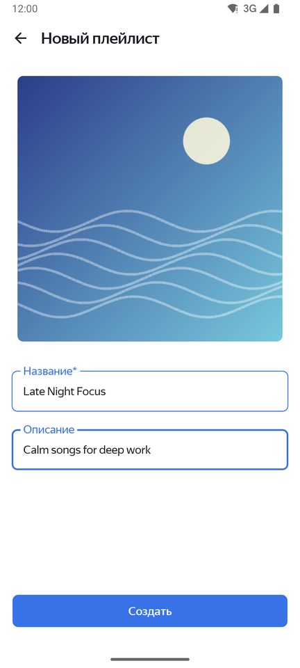<br><sub>New playlist</sub></td>
    <td align="center">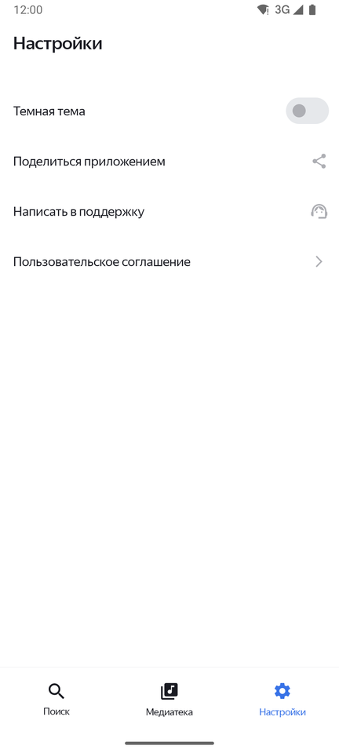<br><sub>Settings</sub></td>
  </tr>
</table>

<details>
<summary><b>Dark theme</b></summary>
<br>

<table>
  <tr>
    <td align="center">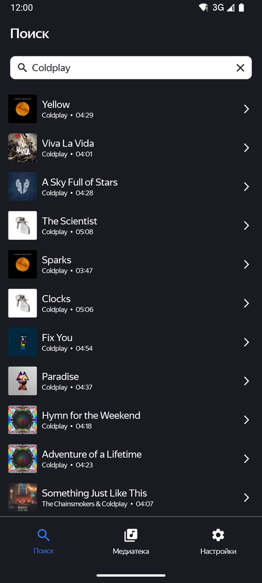<br><sub>Search</sub></td>
    <td align="center">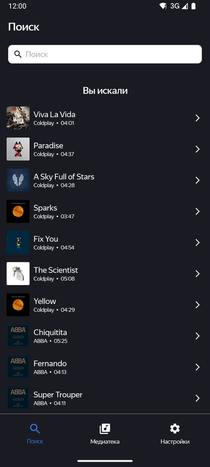<br><sub>Search history</sub></td>
    <td align="center">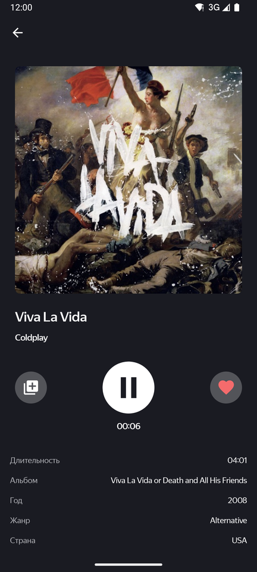<br><sub>Audio player</sub></td>
    <td align="center">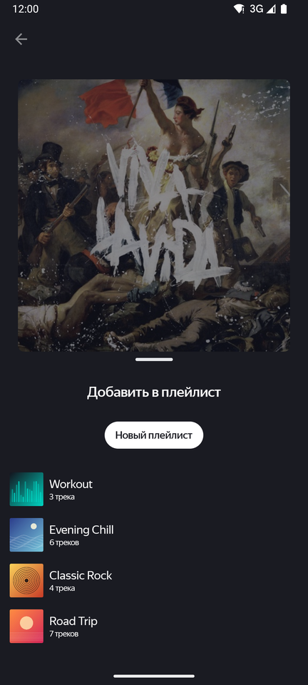<br><sub>Add to playlist</sub></td>
    <td align="center">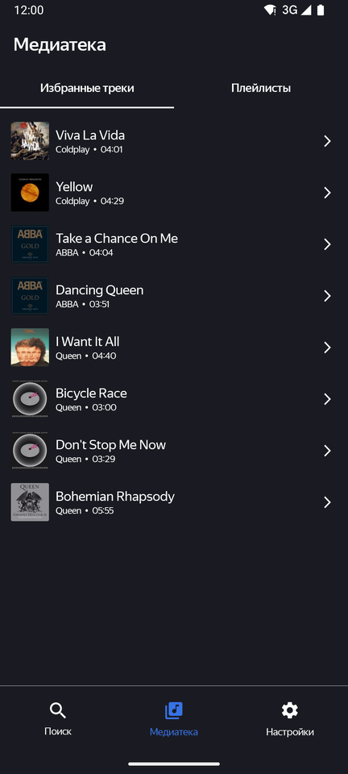<br><sub>Favorite tracks</sub></td>
  </tr>
  <tr>
    <td align="center">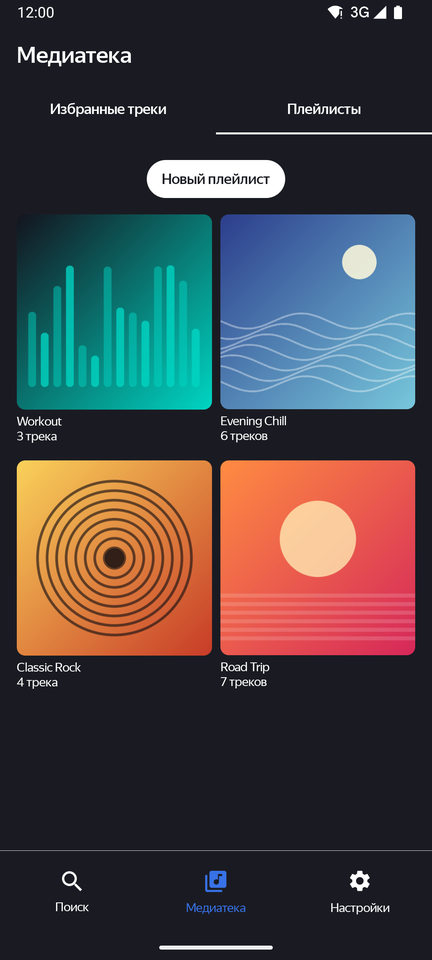<br><sub>Playlists</sub></td>
    <td align="center">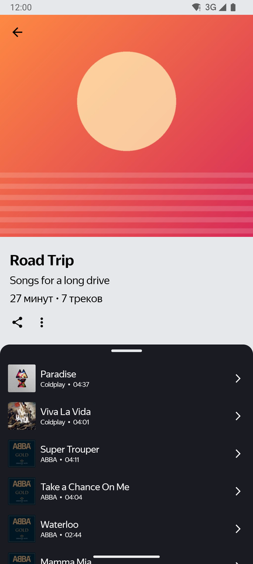<br><sub>Playlist</sub></td>
    <td align="center">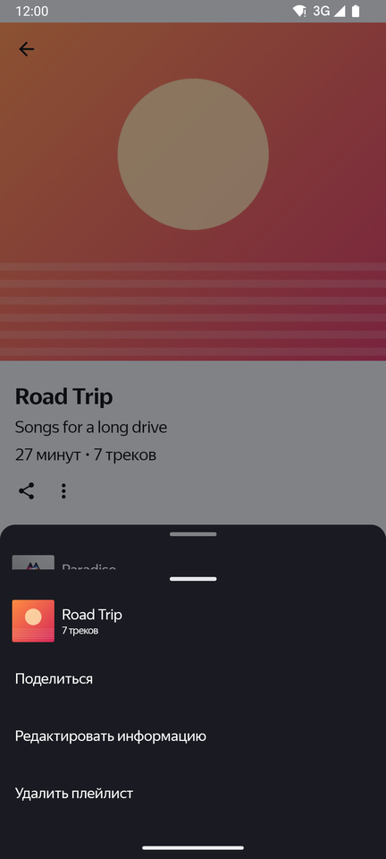<br><sub>Playlist menu</sub></td>
    <td align="center">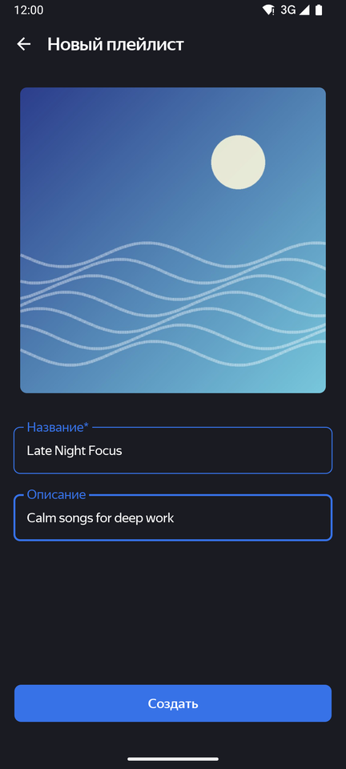<br><sub>New playlist</sub></td>
    <td align="center">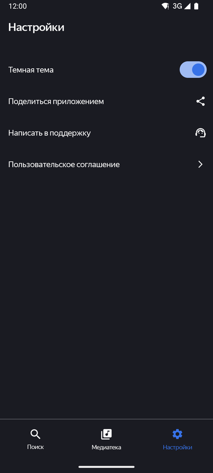<br><sub>Settings</sub></td>
  </tr>
</table>

</details>

---

## Tech Stack

| Area | Tools |
|---|---|
| Language | Kotlin 2.0 |
| UI | Jetpack Compose, Material 3 |
| Navigation | Navigation Compose with type-safe routes (kotlinx.serialization) |
| Architecture | Clean Architecture + MVVM, feature-based packages |
| DI | Koin |
| Async | Kotlin Coroutines, Flow / StateFlow, LiveData |
| Network | Retrofit, Gson converter, OkHttp logging interceptor |
| Database | Room (KSP) |
| Local storage | SharedPreferences (theme, search history) |
| Images | Coil |
| Audio | MediaPlayer inside a bound foreground service |
| Build | Gradle Kotlin DSL, version catalog (`libs.versions.toml`) |

- **Min SDK:** 29
- **Target / Compile SDK:** 36

---

## Architecture

Each feature is split into three layers:

- **UI layer** — composable screens, ViewModels, screen states
- **Domain layer** — interactors, repository interfaces, business models
- **Data layer** — repository implementations, Retrofit API, Room DAOs, SharedPreferences, Android intents

```text
UI → Domain → Data
```

### UI layer

- **Single Activity.** `MainActivity` only calls `setContent { }` and contains no composable definitions.
- **Screens are composables.** Each screen lives in its own `*Screen.kt` file next to its ViewModel; components reused on several screens live in `ui/components`, and the theme (colors, typography) lives in `ui/theme`.
- **State.** ViewModels expose screen state through `StateFlow` or `LiveData`; screens read it with `collectAsStateWithLifecycle()` / `observeAsState()`. One-off events (e.g. "track added to playlist") are delivered through `SharedFlow`.
- **Navigation.** `AppNavHost` describes all destinations; the bottom bar (`BottomAppBar`) is shown only on top-level screens and hides when the keyboard is open. Navigation actions run only while the source screen is resumed, so a double tap does not open or close a screen twice.
- **Side effects.** Binding to the playback service, lifecycle observers and system bar appearance are handled with `DisposableEffect` / `LaunchedEffect`.

### Navigation graph

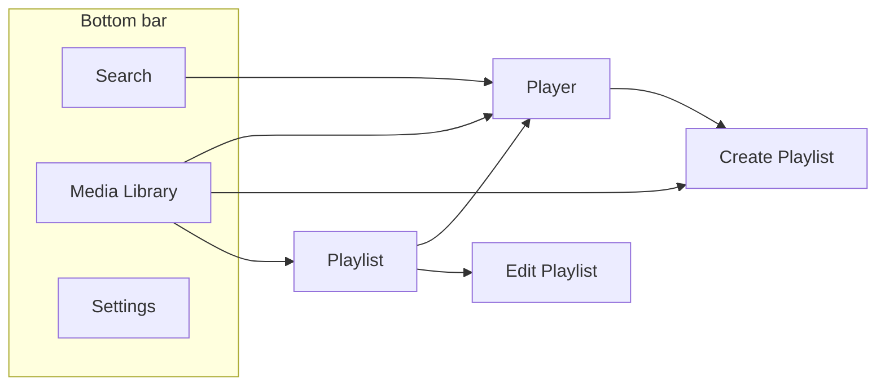

---

## Installation

### Prerequisites

- A recent version of Android Studio that supports Android Gradle Plugin 8.11
- JDK 17 or higher (the JDK bundled with Android Studio works)
- Android SDK 36

### Build Instructions

1. **Clone the repository**
   ```bash
   git clone https://github.com/sasha-zadiraka/PlaylistMaker.git
   cd PlaylistMaker
   ```

2. **Open in Android Studio**
   - Select "Open" and choose the cloned folder
   - Wait for the Gradle sync to finish

3. **Build the project**
   ```bash
   ./gradlew assembleDebug   # debug APK for running on a device
   ./gradlew build           # all build variants + lint and unit tests
   ```

4. **Run on a device or emulator**
   - Connect an Android device (Android 10+) or start an emulator
   - Click "Run" in Android Studio

---

## Project Structure

```
app/src/main/java/com/playlistmaker/
├── creator/             # Application class, Koin start-up
├── di/                  # Koin modules: data, repositories, interactors, ViewModels
├── data/db/             # Room database, DAOs and entities shared by features
├── main/ui/             # MainActivity, root composable (Scaffold + bottom bar)
│   └── navigation/      # Routes, NavHost, bottom bar
├── search/              # Track search and search history
├── player/              # Audio player screen, playback service
├── medialibrary/        # Media library: favorite tracks and playlists tabs
├── playlist/            # Playlist screen, create / edit playlist
├── settings/            # Settings screen, theme
├── sharing/             # Sharing, email and links (external navigation)
├── ui/
│   ├── components/      # Reusable composables (track item, buttons, dialogs, ...)
│   └── theme/           # Colors, typography, PlaylistMakerTheme
└── util/                # Constants and helpers
```

Feature packages follow the same layout: `data/`, `domain/` and `ui/`.

---

## Contributing

Contributions are welcome! Please feel free to submit a Pull Request.

1. Fork the project
2. Create your feature branch (`git checkout -b feature/AmazingFeature`)
3. Commit your changes (`git commit -m 'Add some AmazingFeature'`)
4. Push to the branch (`git push origin feature/AmazingFeature`)
5. Open a Pull Request

## Author

- GitHub: [@sasha-zadiraka](https://github.com/sasha-zadiraka)
- LinkedIn: [Aleksandra Zadiraka](https://www.linkedin.com/in/aleksandra-zadiraka/)

---

<div align="center">

Made with love by Aleksandra Zadiraka

Star this repo if you find it helpful!

</div>
